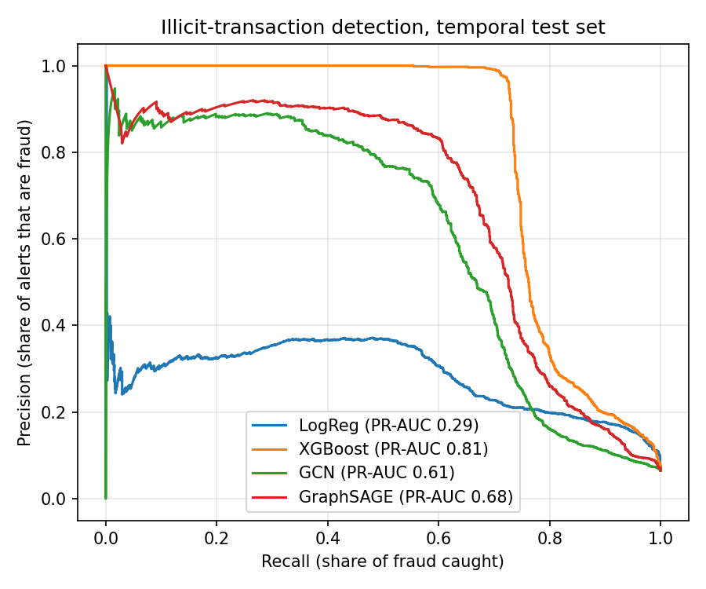
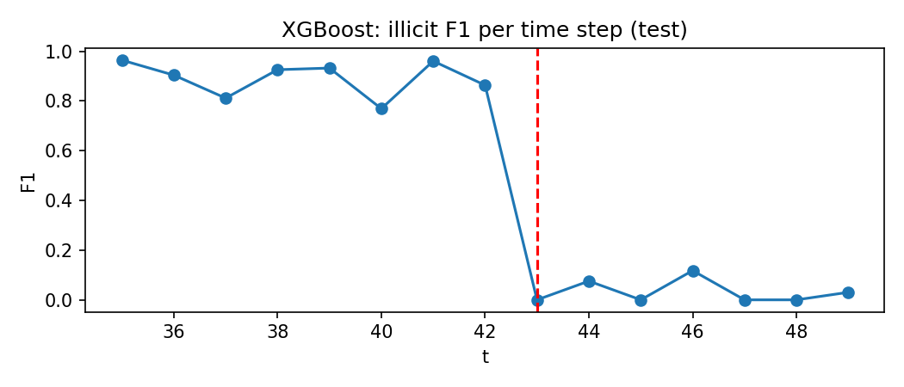

# Fraud Detection on a Payment Graph: GNNs vs Gradient Boosting

Detecting illicit transactions in the **Elliptic Bitcoin dataset**. It holds 203,769 transactions (nodes), 234,355 payment flows (edges) and 165 features per transaction. Only about 10% of the labelled transactions are illicit.

This project compares **graph neural networks** (GCN, GraphSAGE) with **tabular models** (Logistic Regression, XGBoost). It uses a realistic **temporal split**: train on time steps 1–34 and test on future time steps 35–49.

## Approach
- **Temporal split.** The model trains on the past and predicts the future, as a deployed fraud model would. 15% of the training nodes are held out for validation.
- **No data leakage.** Feature scaling is fitted on training nodes only.
- **Class imbalance.** Uses `class_weight='balanced'` for LogReg, `scale_pos_weight` for XGBoost, and a class-weighted cross-entropy loss for the GNNs.
- **Threshold tuning.** The alert threshold is chosen to maximise F1 on validation, then applied unchanged to test.
- **Metrics.** Precision, recall, F1 and PR-AUC on the illicit class. Accuracy is not used because it is misleading at a 10% positive rate.
- **GNNs.** Two-layer GCN and GraphSAGE models (PyTorch Geometric) with early stopping on validation PR-AUC.

## Results (temporal test set, illicit class)

| Model | Precision | Recall | F1 | PR-AUC |
|---|---|---|---|---|
| Logistic Regression | 0.227 | 0.704 | 0.343 | 0.286 |
| **XGBoost** | **0.872** | **0.734** | **0.797** | **0.807** |
| GCN | 0.832 | 0.416 | 0.555 | 0.609 |
| GraphSAGE | 0.799 | 0.613 | 0.694 | 0.678 |

## Key findings
1. **Gradient boosting beat the GNNs.** XGBoost reached F1 0.80, against 0.69 for GraphSAGE and 0.56 for GCN. The engineered features already include neighbourhood aggregates, so the graph layers added little and over-smoothed the minority class. GraphSAGE did better than GCN because it keeps each node's own features separate from its neighbours'.
2. **Validation hid a generalisation gap.** The GCN scored PR-AUC 0.93 on validation (the same time period as training) but only 0.61 on future time steps.
3. **Concept drift.** Broken down by time step, XGBoost's F1 stays between 0.8 and 0.96 up to step 42. After the dark-market shutdown at **step 43**, it falls to about 0. Every model failed on the new fraud patterns, and a single overall score would hide this.

## What I would do in production
- Monitor F1 and alert rates by time window, and set up drift alerts and scheduled retraining.
- Feed GNN node embeddings as extra features into XGBoost, as a hybrid model.
- Add explainability, using SHAP for XGBoost and GNNExplainer for the GNNs, so investigators can see why a transaction was flagged.
- Choose the threshold from business costs (missed fraud vs. analyst time) rather than from F1 alone.

## Run it
Open `GNN_Fraud_Detection_Elliptic.ipynb` in Google Colab and click **Runtime → Run all**. The dataset downloads automatically through PyTorch Geometric.

**Stack:** Python, PyTorch, PyTorch Geometric, XGBoost, scikit-learn, pandas, matplotlib

*Dataset: Weber et al. (2019), "Anti-Money Laundering in Bitcoin: Experimenting with Graph Convolutional Networks for Financial Forensics", Elliptic.*
